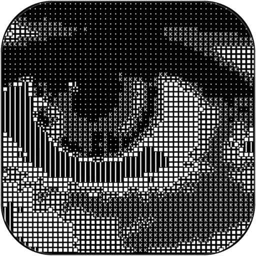

<!-- KhartTool README · v0.2.0 -->

<p align="center">
  
</p>

<h1 align="center">KhartTool</h1>

<p align="center">
  <b>Drop a file. The wheel already knows.</b>
</p>

<p align="center">
  KhartTool is a free, offline drag-and-drop file tool for Windows 10 and 11.<br>
  A small pill sits at the top of your screen: drop files on it to convert, compress, clean and batch-process<br>
  images, PDFs, Word files, spreadsheets, audio, video and archives. No uploads, no account, no telemetry.
</p>

<p align="center">
  <a href="https://github.com/AKhart1/KhartTool/releases/latest"></a>
  
  
  <a href="#-license"></a>
</p>

<p align="center">
  <a href="https://github.com/AKhart1/KhartTool/releases/latest"><b>⬇️ Download for Windows</b></a>
  &nbsp;·&nbsp; <a href="#-presets-your-whole-workflow-in-one-drop">Presets</a>
  &nbsp;·&nbsp; <a href="#-whats-new-in-v02">What's new</a>
  &nbsp;·&nbsp; <a href="#-how-it-works">How it works</a>
  &nbsp;·&nbsp; <a href="#-supported-formats">Formats</a>
  &nbsp;·&nbsp; <a href="#-free-and-pro">Free &amp; Pro</a>
  &nbsp;·&nbsp; <a href="#-faq--troubleshooting">FAQ</a>
</p>

---

## 👁️ What is KhartTool?

Most of the time you just want to change a file: a HEIC photo to JPG, a 40 MB PDF small enough to email, a video's soundtrack as an MP3, or a photo without the GPS location of your home inside it. That usually means uploading the file to a website you don't trust, or installing a huge suite to change one extension.

**KhartTool sits as a small pill at the top of your screen.** Drag files onto it and a glass **wheel** offers only the actions that make sense for those files. The result is saved next to the original. Everything happens on your PC.

| You want to… | With KhartTool |
| :--- | :--- |
| Shrink 5 photos for the web | Drop them on the pill with the **Web images** preset selected |
| Turn a PDF into an e-book or Word file | <kbd>Shift</kbd>-drag the PDF and pick **EPUB** or **DOCX** |
| Post a photo without location data | <kbd>Ctrl</kbd>-drag it and pick **Strip metadata** |
| Get the sound out of a video | <kbd>Shift</kbd>-drag the `.mp4` and pick **Extract MP3** |
| Turn a spreadsheet into CSV or JSON | <kbd>Shift</kbd>-drag the `.xlsx` and pick **CSV** or **JSON** |
| Zip a folder for a client | <kbd>Ctrl</kbd>-drag it and pick **Archive** |

---

## 🔁 Presets: your whole workflow in one drop

**A preset is a recipe.** You chain the steps once (resize → convert → strip metadata → ZIP, say) and pick the preset in the pill. After that, every file you **drop** on the pill runs through the whole chain. There's no wheel to open and no dialog to click through. Drop, and it's done.

```text
  holiday.jpg ─┐
  beach.png   ─┼──▶  [ Web images ]  ──▶  holiday.webp · beach.webp · sunset.webp
  sunset.jpg  ─┘     Resize 1920 px → WEBP 80% → Strip metadata
```

### Start in one click: 9 ready-made templates

| Template | What it does | Steps |
| :--- | :--- | :--- |
| 🌐 **Web images** | Light, private web pictures | Resize to 1920 px → WEBP 80% → Strip metadata |
| ✉️ **Email photos** | JPGs under 1 MB each | Resize to 2560 px → Compress to 1,000 KB → Strip metadata |
| 📷 **Instagram post** | Feed-ready 4:5 posts | Crop 4:5 → 1080 px wide → JPG 90% → Strip metadata |
| 🧾 **Scan to PDF** | Phone scans as one document | One PDF from all images → Compress PDF |
| 📦 **Client delivery** | A clean hand-off package | JPG 92% → 3000 px → Strip metadata → ZIP named `{preset}-{date}` |
| 🎙️ **Voice to MP3** | Voice notes that play anywhere | Convert to MP3 → Strip tags |
| 🎧 **Podcast** *(Pro steps)* | Even loudness, small files | Normalize to −16 LUFS → MP3 → 128 kbps |
| 📱 **Social clip** *(Pro steps)* | Vertical clip for Reels/Shorts | Crop 9:16 → First 60 s → Compress |
| 📝 **PDF to Word** | Editable documents | PDF → DOCX |

Use them as they are, or edit a copy to make it yours.

### Build your own in a minute

1. Open the preset list in the pill and choose **+ New preset**.
2. Name it, then add steps with **+ Add step**. Drag them to reorder.
3. Press **Try on a file** to check the result on a sample before you save.
4. **Save**, pick it in the pill, and drop files on it.

The editor only offers steps that fit. After *Extract audio*, for example, only audio steps appear, so you can't build a chain that breaks.

### 37 steps to chain

| Files | Steps |
| :--- | :--- |
| 🖼️ **Images** | Convert · Resize · Compress (quality or target KB) · Strip metadata · Crop to ratio · Rotate · One PDF · Adjust colour 🔒 · Text watermark 🔒 · AI check report 🔒 |
| 🎵 **Audio** | Convert · Strip tags · Normalize 🔒 · Trim 🔒 · Channels 🔒 · Compress 🔒 · Fade 🔒 |
| 🎬 **Video** | Convert · To GIF · Extract audio · Strip metadata · Compress 🔒 · Trim 🔒 · Speed 🔒 · Mute 🔒 · Crop to ratio 🔒 |
| 📄 **PDF & Word** | PDF to Word · PDF to images · PDF to EPUB · Merge PDFs · Split pages · Strip metadata · Word to PDF · Compress PDF (free for one file) |
| 🏁 **Finish with** | **Rename** with a pattern · **Save to folder** · **ZIP all** |

🔒 = Pro step

### Tricks worth knowing

- **Rename patterns:** `{name}`, `{preset}`, `{n}` and `{date}`. For example, `{preset}-{date}-{n}` gives `Web-images-2026-11-27-01.webp`.
- **One output folder per preset:** end with *Save to folder*, and every result from that preset lands in one place.
- **Ready to send:** end with *ZIP all* and you get one archive instead of a pile of files.
- **Share presets:** **Share** exports a `.ktpreset` file a friend can **Import**. For safety, an imported preset never brings its own save folder: the person importing picks one.
- **Your originals are never touched.** Each file is copied to a temporary folder first, results keep their original names (`holiday.webp`, not `holiday_resized_converted.webp`), nothing is overwritten (`_1`, `_2`…), and one broken file never stops the rest.
- **Manage** opens the list of all your presets: edit, copy, delete, import and share them, and switch them on or off.

> [!TIP]
> On the free version you can keep **2 custom presets** plus every template that uses only free steps, with up to 5 files per drop. Presets with 🔒 steps will unlock with KhartTool Pro.

---

## ✨ What's new in v0.2

v0.2 is the biggest update so far: **42 commits, about 140 files changed** since v0.1.2.

> [!IMPORTANT]
> **Free output is now real.** The v0.1.x test builds saved blank placeholder files. v0.2 saves your actual converted files.

- 🎨 **A new look.** Dark liquid-glass panels, glass buttons and switches, and an **animated eye logo** that opens, looks around and blinks.
- 🧭 **First-run setup and a wheel you design yourself.** Pick what you work with (Photos, Screenshots, Documents & PDF, Audio & podcasts, Video, Archives), then tick, untick and drag slices with a live preview. Up to 12 slices per wheel. Export and import your layout as a file.
- 🔁 **Custom presets for every file type.** Chain any of 37 steps (convert, resize, compress, crop, rotate, watermark, normalize, trim, merge, rename, ZIP…) for images, audio, video, PDF and Word. 9 ready-made templates, and share presets as `.ktpreset` files. [See presets ↑](#-presets-your-whole-workflow-in-one-drop)
- 🗂️ **40+ new formats and conversions.** AVIF, PSD, SVG, JPEG 2000, TGA, Opus, AIFF, ALAC, WMA, MKV, AV1, ProRes, XLSX, EPUB, PPTX, 7Z, RAR, TAR and more. [Full list ↓](#-supported-formats)
- 📚 **New document conversions.** PDF → EPUB, HTML, JPG/PNG pages, XLSX and PPTX; Word → EPUB and HTML; text and Markdown → EPUB; XLSX ↔ CSV/JSON.
- 🗜️ **Archive window.** Create ZIP, 7Z or RAR with a compression level, an AES-256 password and hidden file names. Extract ZIP, 7Z, RAR and TAR archives.
- 🔍 **AI check.** An honest, offline look at whether an image, video or audio file carries proof of AI generation (signed Content Credentials / C2PA). It never guesses "not AI".
- 🩹 **17 conversion bugs fixed**, each with a real-file test. Compress PDF works again, phone photos are no longer saved sideways, Polish, Cyrillic and Chinese text survives PDF export, Join videos handles clips of different sizes, and animated GIFs stay animated.
- ⚡ **Faster start-up.** A 10-second freeze at launch on some PCs (sound-device lookup) is gone.
- 🔒 **Security updates.** Pillow 13 and PySide6 6.11.3 with their CVE fixes. Shared presets can no longer choose where your files are saved. Helper programs (7-Zip, FFmpeg) are never loaded from the current folder.

---

## 👆 How it works

KhartTool has three gestures. You never have to open a menu first.

| Gesture | What happens |
| :--- | :--- |
| **Drop** files on the pill | Runs the **preset** selected in the pill (for example *Web images*) |
| Hold <kbd>Shift</kbd> while dragging | Opens the **formats wheel**: drop on JPG, PDF, MP3, EPUB… |
| Hold <kbd>Ctrl</kbd> while dragging | Opens the **tools wheel**: compress, crop, trim, metadata, archive, AI check… |
| <kbd>Shift</kbd> + <kbd>F</kbd> on the pill | Converts the last dropped files to your default format |

Results are saved **next to the original file** (or in one output folder of your choice). Existing files are never overwritten: new files get `_1`, `_2`… Every write goes to a temporary file first and is moved into place only when it is complete, so a crash can't leave a half-written file.

Drop a whole folder and KhartTool walks through it (up to 5,000 files). Drop a mix of file kinds and you can still zip them together.

---

## 🧰 Features

<details open>
<summary><b>🖼️ Images</b></summary>

- Convert between JPG, PNG, WEBP, AVIF, GIF, BMP, ICO, TIFF, TGA and JPEG 2000; save one PDF per image or **all images in one PDF**
- Phone photos keep the right orientation; CMYK print images convert cleanly; animated GIF and WEBP stay animated
- Resize with the aspect ratio locked, and compress to a quality level or a target size in KB
- **Strip metadata** in one click: EXIF, GPS, camera data
- Edit window (Pro): colour, rotate, blur, redact, crop · **Frame** (Pro): presentation-ready screenshots on gradient backgrounds
- Favicon pack (Pro): ICO + 16–512 px PNGs · Camera RAW (16 types) and SVG input (Pro)
- HEIC/HEIF from iPhones through a [free optional add-on](#-heic-add-on-iphone-photos)

</details>

<details>
<summary><b>📄 PDF, Word, text and spreadsheets</b></summary>

- **PDF →** DOCX, TXT, Markdown, HTML, EPUB, JPG/PNG (one image per page), XLSX and PPTX (Pro)
- **Word (DOCX) →** PDF, TXT, HTML, EPUB, with headings, lists and tables kept
- **Text and Markdown →** PDF, DOCX, HTML, EPUB (Markdown is rendered properly)
- **JSON and CSV →** PDF, DOCX; JSON ⇄ CSV (nested keys flattened); CSV/JSON → XLSX
- **XLSX →** CSV, JSON, HTML
- Merge PDFs, split pages, strip PDF metadata; **Compress PDF** (free for one file at a time)
- Unicode-safe PDF export: Polish, Cyrillic and Chinese text no longer turns into ■ boxes

</details>

<details>
<summary><b>🎵 Audio</b></summary>

- Convert to MP3, M4A, WAV, FLAC, plus OGG, Opus, AAC, WMA, AC3, AIFF, ALAC and M4R iPhone ringtones (Pro)
- Tags and album art are kept; edit ID3/Vorbis tags and replace cover art
- Audio studio (Pro): trim, normalize, compress, change channels, bleep sections

</details>

<details>
<summary><b>🎬 Video</b></summary>

- Convert to MP4, MOV, WebM and GIF; extract the sound as MP3
- MKV, AVI, WMV, AV1, ProRes, animated WEBP, Extract M4A/WAV (Pro)
- Video studio (Pro): trim, crop, split, join (any clip sizes), change speed, mute, compress, blur-redact regions
- A clear message instead of a cryptic FFmpeg error (for example "This video has no sound track")

</details>

<details>
<summary><b>🗜️ Archives</b></summary>

- **Archive window:** ZIP (free), 7Z and RAR (Pro), compression None / Fast / Normal / Smallest, AES-256 password and hidden file names (Pro)
- Extract ZIP, 7Z, RAR, TAR, TAR.GZ, TAR.BZ2 and TAR.XZ, here or to a folder. Unsafe paths and links inside archives are skipped
- 7Z uses your installed 7-Zip and RAR uses your installed WinRAR; if one is missing, the option is greyed out with the reason

</details>

<details>
<summary><b>🏷️ Metadata</b></summary>

- A summary card (preview, camera, *Show on map*), a search box and editable cards per group
- Images: description, artist, copyright, date, camera make/model, GPS · Audio: title, artist, album, track, year, genre, cover · PDF: title, author, subject, keywords
- **Remove private info** or **Remove all**, then *Save copy*. Viewing metadata is always free and has no file limit

</details>

<details>
<summary><b>🔍 AI check (Pro)</b></summary>

KhartTool reads the evidence a file carries and tells you what it proves. It does **not** guess from pixels.

| Verdict | Meaning |
| :--- | :--- |
| **Made with AI** | Signed Content Credentials (C2PA) say the file was generated by AI |
| **Edited with AI** | Signed proof of an AI edit or composite |
| **AI tool traces found** | Unsigned traces (Stable Diffusion parameters, ComfyUI workflow, generator names). These can be faked or removed |
| **Camera photo** | Signed capture proof from a trusted camera or phone maker, or unsigned camera EXIF (labelled as such) |
| **No proof either way** | The honest default for screenshots and re-saved images. KhartTool never says "Not AI" |

Credentials are verified **offline** against a bundled C2PA trust list; remote manifest and OCSP lookups are switched off. For a second opinion, **Check online** opens Google's SynthID Detector in your browser, where you upload the file yourself.

</details>

---

## 📂 Supported formats

**Free** means no PRO mark. A drop shows the wheel for that kind of file.

| Kind | Opens | Converts to |
| :--- | :--- | :--- |
| **Images** | JPG/JPEG/JFIF, PNG, WEBP, AVIF, GIF, BMP, ICO, TIFF, PSD (flattened), TGA, JPEG 2000 · HEIC/HEIF *(free add-on)* · SVG, 16 camera RAW types *(Pro)* | JPG, PNG, WEBP, AVIF, GIF, BMP, ICO, TIFF, TGA, JPEG 2000, PDF, One PDF · Favicon pack *(Pro)* |
| **Audio** | MP3, WAV, FLAC, M4A, AAC, OGG, Opus · WMA, AIFF, AMR, AC3, M4B *(Pro)* | MP3, M4A, WAV, FLAC · OGG, Opus, AAC, WMA, AC3, AIFF, ALAC, M4R *(Pro)* |
| **Video** | MP4, MOV, MKV, AVI, WebM, M4V · WMV, FLV, 3GP, MPG/MPEG, TS, MTS/M2TS *(Pro)* | MP4, MOV, WebM, GIF, Extract MP3 · MKV, AVI, WMV, AV1, ProRes, Animated WEBP, Extract M4A/WAV *(Pro)* |
| **PDF** | PDF | DOCX, TXT, Markdown, HTML, EPUB, JPG, PNG · XLSX, PPTX *(Pro)* |
| **Word** | DOCX | PDF, TXT, HTML, EPUB |
| **Text & data** | TXT, MD, JSON, CSV, XML, HTML, LOG, YAML | PDF, DOCX, TXT · Markdown, HTML (not from JSON/CSV) · EPUB (from TXT/MD) · CSV ⇄ JSON · XLSX (from CSV/JSON) |
| **Spreadsheets** | XLSX | CSV, JSON, HTML |
| **Archives** | ZIP, 7Z, RAR, TAR, TAR.GZ/TGZ, TAR.BZ2, TAR.XZ | Extract here, Extract to folder · Create ZIP · 7Z/RAR *(Pro)* |

> [!NOTE]
> HEIC and RAW are input-only. RAW is camera sensor data that nothing can write back, and HEIC output would need a patented HEVC encoder. `.doc` (old Word) isn't supported; save it as `.docx` first.

---

## 💎 Free and Pro

v0.2 is a **free release**. Pro tools are visible on the wheel with a blue **PRO** mark so you can see what's coming, but **Pro is not on sale yet**. It will arrive in a later version. Until then the free version keeps working as it is.

| | **Free** (v0.2) | **Pro** (coming later) |
| :--- | :--- | :--- |
| Output | ✅ Real files | ✅ Real files |
| Files per drop | 5 (viewing metadata: unlimited) | Unlimited |
| Everyday formats | ✅ | ✅ |
| Rare and pro formats (RAW, SVG, AV1, ProRes, ALAC…) | — | ✅ |
| Convert, resize, compress images, strip metadata | ✅ | ✅ |
| Merge/split PDF, PDF ⇄ Word, PDF → EPUB/HTML/images | ✅ | ✅ |
| Compress PDF | One file at a time | ✅ |
| Edit window, Frame | — | ✅ |
| Video and audio studios (trim, crop, join, normalize…) | — | ✅ |
| Custom presets | 2 + all free templates | Unlimited, every step |
| Archives | ZIP | ZIP, 7Z, RAR, passwords |
| AI check | — | ✅ |
| First-run setup, wheel editor | ✅ | ✅ |

Drop more than 5 files and KhartTool offers to do the first 5 now. It never saves blank files and never fails silently.

---

## 📥 Install

**Requirements:** Windows 10 or 11, 64-bit. Nothing else: FFmpeg and all libraries are included.

1. Download the latest release from **[Releases](https://github.com/AKhart1/KhartTool/releases/latest)**:
   - `KhartTool-0.2.0-free-win64-setup.exe`: installer (per-user, no admin rights needed), **or**
   - `KhartTool-0.2.0-free-win64-portable.zip`: unzip anywhere and run `KhartTool.exe`.
2. *(Optional)* Check the download against `SHA256SUMS.txt`:
   ```powershell
   Get-FileHash .\KhartTool-0.2.0-free-win64-setup.exe -Algorithm SHA256
   ```
3. Start KhartTool. The first launch walks you through a one-minute setup; press **Skip** to keep the defaults.

> [!WARNING]
> **Windows SmartScreen** may say *"Windows protected your PC"* because the app isn't code-signed yet. Click **More info → Run anyway**. **Don't turn off your antivirus.**

> [!TIP]
> **Run KhartTool as a normal user, not as administrator.** Windows (UIPI) blocks drag-and-drop from Explorer into an elevated window.

**Optional extras**

| Add-on | What it unlocks | How |
| :--- | :--- | :--- |
| HEIC decoder (`pi-heif`) | iPhone HEIC/HEIF photos | [HEIC add-on guide ↓](#-heic-add-on-iphone-photos), about one minute |
| 7-Zip | Create and extract 7Z, extract RAR | Install from [7-zip.org](https://www.7-zip.org/) |
| WinRAR | Create RAR | Install from [rarlab.com](https://www.rarlab.com/) |

---

## 📱 HEIC add-on (iPhone photos)

HEIC uses the HEVC codec, which is covered by patents, so the decoder is **not part of the download**. It's an optional add-on, [`pi-heif`](https://pypi.org/project/pi-heif/), that you install yourself from PyPI in about a minute. No Python is needed. It only **decodes** HEIC/HEIF; there is no HEIC output. You are responsible for any codec patent licenses that apply to you in your country.

1. Open <https://pypi.org/project/pi-heif/#files> and download the **Windows 64-bit wheel** for KhartTool's Python version. For the current builds (Python 3.11) that's the `cp311-win_amd64` file, named like `pi_heif-1.4.0-cp311-cp311-win_amd64.whl`. If you drop a HEIC file before installing, KhartTool tells you the exact tag it needs.
2. Press <kbd>Win</kbd> + <kbd>R</kbd>, paste `%LOCALAPPDATA%\KhartTool\plugins\heic` and press <kbd>Enter</kbd>. Create the folder if it doesn't exist yet.
3. Put the `.whl` file in that folder. Don't rename or unzip it.
4. Drop the `.heic` file on KhartTool again. No restart is needed.

To remove the add-on, delete the folder. To update it, replace the `.whl` with a newer one.

| Symptom | Fix |
| :--- | :--- |
| "HEIC/HEIF support is an optional add-on and is not installed" | Do steps 1–3 above |
| "does not match this app (needs a 'cpXYZ-win_amd64' wheel)" | Download the wheel with the tag named in the message |
| The wheel is in the folder but HEIC still fails | Delete the `unpacked` folder next to it and try again; check `%LOCALAPPDATA%\KhartTool\logs\app.log` |
| Antivirus quarantines a DLL | The DLLs come straight from the PyPI wheel; restore them or add an exception |

---

## ⚙️ Settings and tray menu

Right-click the tray icon:

- **Show or hide drop bar**
- **Inspect metadata…**
- **Customize wheel…**: the wheel editor, with export/import
- **Output folder…**: next to the original (default), or one folder
- **Start with Windows**
- **About**, **Quit**

<details>
<summary>Where KhartTool keeps its data</summary>

| What | Where |
| :--- | :--- |
| Installed app | `%LOCALAPPDATA%\Programs\KhartTool` |
| Presets | `%LOCALAPPDATA%\KhartTool\presets.json` |
| Logs (crash, app, self-check) | `%LOCALAPPDATA%\KhartTool\logs\` |
| Settings (position, output folder, wheel layout…) | Registry: `HKCU\Software\KhartDev\KhartTool` |
| Autostart entry | `HKCU\Software\Microsoft\Windows\CurrentVersion\Run\KhartTool` |

</details>

---

## 🔒 Privacy and safety

- **100% local processing.** Files never leave your PC.
- **No telemetry, no analytics, no auto-update.** The app never connects to the internet by itself. The only links (a photo's location on a map, the AI check's *Check online*) open in your browser, and only when you click them.
- **Originals are never modified.** Results are new files, written atomically.
- **Safe archive extraction.** Path-traversal entries and links are skipped.
- **Self-check built in.** `KhartTool.exe --self-check` verifies every bundled library and writes a JSON report.

---

## ❓ FAQ / Troubleshooting

<details>
<summary><b>Dropping files does nothing</b></summary>

KhartTool (or the program that started it) is probably running as administrator. Close it and start it normally. Windows blocks drag-and-drop from Explorer into elevated windows.
</details>

<details>
<summary><b>A wheel slice shows a PRO mark</b></summary>

That tool or format belongs to KhartTool Pro, which isn't on sale yet. Everything without the mark works in the free version.
</details>

<details>
<summary><b>Only 5 of my files were converted</b></summary>

The free version handles 5 files per drop. Drop the rest in a second batch. Viewing metadata has no limit.
</details>

<details>
<summary><b>HEIC photos aren't recognised</b></summary>

HEIC decoding isn't bundled because of HEVC patents. Install the free add-on in about a minute: [HEIC add-on guide](#-heic-add-on-iphone-photos).
</details>

<details>
<summary><b>7Z or RAR is greyed out in the Archive window</b></summary>

7Z needs 7-Zip and RAR needs WinRAR installed on your PC; KhartTool uses them, it doesn't bundle them. Hover the option to see the reason.
</details>

<details>
<summary><b>Something crashed</b></summary>

Logs are in `%LOCALAPPDATA%\KhartTool\logs\`. Please attach `crash.log` to an [issue](https://github.com/AKhart1/KhartTool/issues/new).
</details>

---

## 🗺️ Roadmap

- **KhartTool Pro (1.0):** licence keys and a store, unlocking every PRO-marked tool
- Code-signed installer (no more SmartScreen warning)
- Office add-on: DOC, ODT, RTF, XLS, ODS and PPTX input (optional download)
- Opening password-protected archives


---

## 💬 Feedback

Tell us what breaks, what's confusing, or which formats and presets you need:
**[Open an issue](https://github.com/AKhart1/KhartTool/issues/new)** · Website: **[akhart1.github.io/KhartTool](https://akhart1.github.io/KhartTool/)**

---

## 📜 License

**KhartTool is proprietary software.** Copyright © 2026 AKhart1. All rights reserved.

The free edition is licensed, not sold, under the KhartTool Free Edition EULA, included as `LICENSE.txt` in every download. In short, you may use it free of charge on your own devices for personal and internal business purposes. You may not redistribute, resell, modify or reverse engineer it, or get around its feature limits. The source code is not published.

<details>
<summary><b>Open-source components</b></summary>

Releases include open-source software that stays under its own licenses; the EULA doesn't limit the rights those licenses give you. Every component and its license text is listed in `THIRD_PARTY_NOTICES.txt` and the `licenses` folder of each release.

- **FFmpeg** (separate program in `bin\`, GNU GPL v3, built with libx264) powers audio and video. Its corresponding source is published as a `deps-ffmpeg-<version>-slim` release; the exact tag is named in `THIRD_PARTY_NOTICES.txt`.
- **Qt / PySide6** (GNU LGPL v3, dynamically linked and replaceable), including the FFmpeg libraries bundled with Qt Multimedia (LGPL).
- **LibRaw** via rawpy (LGPL / CDDL), **Pillow**, **pypdf**, **pypdfium2**, **python-docx**, **python-pptx**, **openpyxl**, **ReportLab**, **pyzipper**, **c2pa-python** and others.
- HEIC decoding is **not** included; it's an optional add-on you install yourself.

</details>

<p align="center">
  <sub>Built with care by <a href="https://github.com/AKhart1">AKhart1</a>, a computer engineering enthusiast.</sub>
</p>
