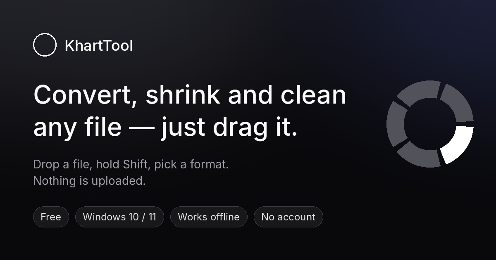

# KhartTool

**Convert, shrink and clean any file — just drag it.**
A small, free Windows app that sits on your desktop. Drop a photo, video, song or document on it, hold **Shift** and pick a format, or hold **Ctrl** for tools. The new file appears next to the original. Nothing is uploaded.

**[Website](https://akhart1.github.io/KhartTool/)** · **[Download](https://github.com/AKhart1/KhartTool/releases/latest)** · **[Report a problem](https://github.com/AKhart1/KhartTool/issues/new)** · **[Discussions](https://github.com/AKhart1/KhartTool/discussions)**



---

## What you can do with it

- **Share photos without sharing where you live:** remove location and camera data from photos.
- **Fix "attachment too large":** turn phone photos into one PDF, then compress it.
- **Speed up a shop or blog:** resize and convert a whole folder of images to WebP in one drop.
- **Grab the audio, make a GIF, cut the boring bit:** extract MP3, convert to GIF/WebM/MP4, trim, mute, change speed.
- **Hide names in screenshots:** blur, redact or crop before posting.
- **Change document formats:** PDF, DOCX, TXT, CSV, JSON and Markdown.
- **Pack files:** select several files and make a ZIP.

## How it works

| You do | KhartTool does |
| --- | --- |
| Drag a file onto the bar and hold **Shift** | Opens the **format wheel**: release on the format you want |
| Drag and hold **Ctrl** | Opens the **tool wheel**: compress, crop, ZIP, remove hidden data and more |
| Pick a **preset**, then drop a file or a whole folder | Runs every step on every file, no key needed |

Results are saved **next to the original**.

### Supported in 0.1.0

| Type | Shift: convert to | Ctrl: tools |
| --- | --- | --- |
| Images | JPG, PNG, WebP, TIFF, PDF | ZIP, Metadata, Compress, Color, Rotate, Blur, Redact, Crop |
| Video | MP4, WebM, GIF, MP3 (audio only) | Compress, Change speed, Extract MP3, Mute, Trim, Crop, Split, Redact |
| Audio | MP3, WAV, FLAC, OGG | Compress, Metadata, Normalize, Trim, Channels, Bleep |
| Documents | PDF, DOCX, TXT, JSON, CSV, Markdown | Compress PDF, Split pages, Images to PDF, Strip PDF metadata |

### Built-in presets

- **Web Optimizer:** resize to 1920 px → remove hidden data → save as WebP.
- **Privacy Cleaner:** remove location and camera data → keep the same format.

## Download and install

Requires **Windows 10 or 11 (64-bit)**. Get both files from the **[latest release](https://github.com/AKhart1/KhartTool/releases/latest)**:

| File | Choose it if |
| --- | --- |
| `KhartTool-…-win64-setup.exe` | You want a Start-menu shortcut and a normal uninstaller (recommended) |
| `KhartTool-…-win64-portable.zip` | You want to run it from a folder or USB stick without installing |

1. Download one of the files above.
2. **If Windows SmartScreen warns you:** KhartTool isn't code-signed yet, so Windows may show "Windows protected your PC". Click **More info → Run anyway**. You don't need to turn off Defender.
3. Drag your first file onto the KhartTool bar and hold **Shift**.

**To uninstall:** use Settings → Apps for the installer version, or delete the folder for the portable version.

### Check your download (optional)

Each release lists the **SHA-256 checksum** and a **VirusTotal scan** for every file. Compare the checksum in PowerShell:

```powershell
Get-FileHash .\KhartTool-0.1.0-win64-setup.exe
```

## Privacy

- Works **fully offline**: your files are processed on your PC and never uploaded.
- **No ads, no account, no telemetry.** The only network request is optional licence activation, and only if you start it yourself.
- It only touches files you drag onto it, and writes new files next to them.

## Coming next (v0.2)

- **Your own presets:** chain several actions and run them on many files at once.
- **Your own wheels:** choose which formats appear on Shift and which commands appear on Ctrl.
- **Many more formats:** the goal is nearly every file type you use, for example AVIF and HEIC.

Tell us what to build first through the [feedback form](https://akhart1.github.io/KhartTool/#feedback) or [Discussions](https://github.com/AKhart1/KhartTool/discussions).

## Feedback and bugs

KhartTool is an early version (0.1.0), so honest feedback helps a lot.
When you [open an issue](https://github.com/AKhart1/KhartTool/issues/new), please include what you dropped, what you expected and what happened.

---

KhartTool 0.1.0 · KhartDev · Free Edition
